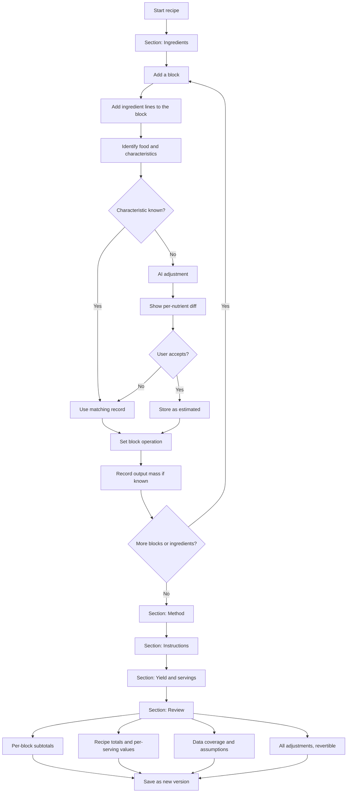

# Patch for `NutriPlan_MVP_Product_Specification_v0.3.md`

**Prepared:** 12 November 2026
**Status:** Proposed insertions — not yet applied to the source document
**Scope:** Recipe workflow (block/component model), AI stance, and the
decisions that follow from them

> Apply by pasting each part into the matching section of v0.3. Decision IDs
> are new (D-013 onward) and must not be renumbered. This file follows the
> source document's change-control rules (§1).

---

## Part A — New decisions for the register (§5)

### D-013 — A recipe is a reusable named unit, not a container

**Status:** Proposed

A **recipe** is a named, multi-ingredient thing the user refers to and
reuses ("Paneer bhurji", "Overnight oats", "Mom's dal").

- A single ingredient with a preparation state is a **food** (e.g. egg,
  boiled; carrot, raw), not a recipe.
- An ad-hoc combination eaten once is the **contents of a meal slot**
  (e.g. milk + cereal at breakfast), not a recipe.
- A **"Save as recipe"** action promotes a meal slot's contents into a
  named recipe when the user wants to reuse it.

The boundary is decided by the user's intent to reuse, not by ingredient
count. There is one recipe model; the interface adapts to complexity.

**Why it matters:** Resolves §7.3 Q1 without a parallel "simple recipe"
system, and stops one-off combinations from polluting the recipe library.

---

### D-014 — Recipe creation is a staged, sectioned flow

**Status:** Proposed

Creating a recipe moves through ordered sections, and the user can leave
and resume:

1. **Ingredients** — added one at a time, organised into blocks (D-021).
2. **Method** — how the dish is made at the recipe level.
3. **Instructions** — the written procedure, saved as part of the recipe.
4. **Yield and servings** — final cooked weight, serving count.
5. **Review** — totals, per-serving values, data coverage, and every
   adjustment the system made.

Sections that do not apply collapse rather than being removed, so the
interface adapts without a separate simple-recipe product.

**Why it matters:** Resolves §7.3 Q3 and gives the AI adjustment review a
defined home in the flow.

---

### D-015 — Ingredients carry their own characteristics and preparation state

**Status:** Proposed

Each ingredient line stores, independently of the others:

- Food identity (D-003, D-005).
- Characteristics relevant to that food (see §8.1), each marked
  `explicit`, `defaulted`, `ai-inferred` or `unknown` (D-004).
- Ingredient-level preparation (D-006).
- Quantity and unit.

The available characteristic set is defined per food, not globally. A
banana offers ripeness and size; rice offers variety and raw/cooked;
garlic offers fresh/powder. The user is never forced to answer.

**Why it matters:** This is the input that makes AI adjustment possible
and keeps the adjustment defensible.

---

### D-016 — AI adjustments are disclosed as a per-nutrient diff

**Status:** Proposed

When a characteristic is unknown or ambiguous (for example, "overripe
banana"), the system may adjust nutrient values. Every adjustment must be
presented to the user as a **per-nutrient diff** before the recipe is
saved:

| Field | Meaning |
|---|---|
| `nutrient` | Which nutrient changed |
| `reference_value` | Value from the matched food record |
| `adjusted_value` | Value after adjustment |
| `delta` | The change |
| `rationale` | Plain-language reason ("overripe: starch converted to sugars") |
| `evidence` | Source records, method/model version |
| `status` | `estimated`, `known` or `unknown` |
| `revertible` | Always yes |

Rules:

- Adjustments are stored with status `estimated`, never `known` (D-008).
- Confidence is derived from evidence quality and data coverage, never
  from the model's self-reported confidence (D-009).
- The user can revert any nutrient to its reference value, or the whole
  ingredient.
- An adjustment is never silent. If nothing was adjusted, nothing is
  shown.
- Adjustments are **recipe-scoped**: they belong to an ingredient line or
  a block inside a recipe version. The global food record is never
  rewritten.

**Why it matters:** This is the trust mechanism for an AI-required
product. It is also the concrete form of D-010's "How was this
calculated?".

---

### D-017 — Cooking instructions are stored as evidence and AI context

**Status:** Proposed

The written instructions are saved with the recipe version and used as
context for AI interpretation. They are **not** deterministically parsed
in the MVP, and they do not by themselves change nutrient values.

The AI may read the instructions and *suggest* ingredient preparations or
a cooking method; the user reviews and accepts (D-006).

**Why it matters:** Keeps the valuable audit trail without committing to
a text-to-steps parser in v1.

---

### D-018 — Recipe change semantics: edit, version and variant are distinct

**Status:** Proposed

- **Edit** changes the recipe's current version and produces a new
  version. Plans that already used the old version are unaffected.
- **Version** is an immutable snapshot captured when a recipe is saved or
  used in a plan. Historical plans pin the version they used.
- **Variant** is a named fork (`parent_recipe_id`) created by "Duplicate
  & customise". It is independently editable and has its own versions.

Ingredient-level substitutions (garlic → garlic powder) are performed by
editing an ingredient line inside a variant. A reusable
`food_substitutions` catalogue is deferred.

**Why it matters:** Resolves §7.3 Q5 and Q6, and the open "Recipe
variations" row in §12.

---

### D-019 — AI is required for the designed experience, but degrades gracefully

**Status:** Proposed

The product is designed around AI interpretation, matching and
estimation, and AI is on by default. AI is not a single point of failure:

- Every AI-assisted step has a defined non-AI outcome.
- When evidence is insufficient (§8.2), the user sees an explicit
  insufficient-evidence state and may accept a reference profile, supply
  label values, or leave the nutrient `unknown`.
- AI never fabricates a value to complete a field (D-007).

**Why it matters:** Makes "AI required" a design stance rather than an
availability guarantee, and preserves D-007's integrity.

---

### D-020 — Packaged-food labels must declare their basis

**Status:** Proposed

Every label-derived record stores:

- `basis` — `per_100g`, `per_serving` or `per_pack`.
- `state` — `as_sold` or `as_prepared`.
- `serving_size_g`, `servings_per_pack`.
- The label image as evidence, not as the parsed source of truth.

%DV is never stored as truth; store the absolute value and the reference
used.

**Why it matters:** F22 is already in the test suite while §10 leaves the
workflow open. Without an explicit basis, the same packet can be read as
values differing by 20× or more.

---

### D-021 — Recipes are composed of blocks (components), not flat lists

**Status:** Proposed

A recipe version is an **ordered list of blocks**. A block is a small
processing unit with:

- **Inputs** — one or more ingredient lines (food, characteristics,
  quantity, unit).
- **Operation** — an optional cooking action (grate, dice, boil, fry,
  mix, assemble).
- **Output** — an optional intermediate mass produced by the block.

A recipe with a single block is equivalent to a flat ingredient list, so
simple recipes do not need the full structure.

Blocks are local to a recipe version by default. A block can be saved as
a **reusable component**, which is a recipe with `kind = component`, and
another recipe can insert that component as a block input. Inserted
components are **pinned to a specific version** (D-023).

**Why it matters:** Matches how the user actually describes cooking,
gives per-block subtotals, and creates a natural recomputation boundary.
Aligns with Galley, ESHA Genesis, FoodCore and recipe_grid.

---

### D-022 — Operations are nutritionally inert without an explicit yield adjustment

**Status:** Proposed

An operation tag (grate, boil, fry) does not change nutrient values by
itself. It affects the calculation only when the user records one of:

- A measured output mass ("200 g raw carrots → 180 g after boiling").
- A moisture or fat loss amount or percentage.
- A validated retention factor from an approved source.

The system never invents a cooking loss.

| Operation | Nutritional effect |
|---|---|
| Grate, dice, slice, mix, assemble | None |
| Boil, drain | Mass change; possible leaching |
| Fry, bake, grill | Mass loss; added fat is already an input |
| Cool, rest | None |

**Why it matters:** Prevents fabricated precision (D-007) while still
letting blocks follow real cooking steps. Mirrors ESHA Genesis's
loss/target model.

---

### D-023 — Reused components are pinned, not live-linked

**Status:** Proposed

A reusable component is a recipe with `kind = component`. Inserting one
into another recipe creates a reference to a **specific component
version**, not a live link.

- Editing the component creates a new version; existing parents keep the
  pinned version.
- Parents show a "newer version available" indicator; updating is an
  explicit user action.
- A component referenced by any recipe version cannot be hard deleted; it
  is archived instead.
- The parent stores the component's source path so a rolled-up total can
  be traced back through the chain.

There is no automatic cascade. This keeps D-018's snapshot rule intact
and makes reference cycles impossible by construction.

**Why it matters:** Gives reuse without the version-drift problems that
live-linked sub-recipes create in ESHA/FoodCore-style tools.

---

### D-024 — Recipe versions store a computed nutrition snapshot

**Status:** Proposed

Saving a recipe version stores the computed result alongside the
structure: per-nutrient totals, completeness, per-block subtotals, and
the calculation version.

Recalculation is explicit ("recalculate with latest food data"), not
automatic. A later correction to a food record does not silently change
an existing recipe version or any plan that used it.

**Why it matters:** Makes D-018's "immutable snapshot" literally true.
Without it, pinned component chains would still shift whenever
underlying food data changed.

---

### D-025 — One nutrient vocabulary, a small tracked set, and `unknown` as a state

**Status:** Proposed

**Storage rule.** Every nutrient value is stored per 100 g edible
portion and mapped to a controlled vocabulary using INFOODS tagnames
(`ENERC_KCAL`, `PROCNT`, `FAT`, `CHOCDF`, `FIBTG`, `NA`, `FE`, `CA`,
`VITA_RAE`, …). Sources are never stored in their own shape; each source
gets an adapter.

**MVP tracks a core set only.** The MVP records these 18 nutrients
because they are what the progress bars and the user's goals need:

| Group | Nutrients |
|---|---|
| Energy and macros | energy, protein, fat, carbohydrate, fibre, total sugars |
| Minerals | sodium, potassium, calcium, iron, zinc, magnesium |
| Vitamins | vitamin A, vitamin C, vitamin D, vitamin B12, folate |

The vocabulary is **versioned**. Adding a nutrient later is a data
change, not a schema migration. Untracked nutrients are not "missing" —
they are out of scope for the current vocabulary version.

**Every value carries provenance.** `source`, `source_food_code`,
`status` (`known` / `estimated` / `unknown`), and `method`. A blank value
is `unknown`, never zero.

**Coverage is reported, not hidden.** For any food or recipe the system
reports, per nutrient, how many contributing ingredients had a known
value. Energy is reported as partial if any of its macro inputs are
unknown.

**Imports are versioned snapshots.** A source refresh creates a new
snapshot; it never edits records that existing recipes pin (D-024).

**Why it matters:** This is the no-gaps guarantee without the
over-engineering. The schema can represent any nutrient any source
publishes; the MVP fills only what the product actually displays. The
alternative — a schema with fixed columns for energy/protein/fat only —
is the version that creates gaps, because adding iron later would mean
rewriting every stored recipe.

---

### D-026 — Prefer cooked-state records; adjust yield only with evidence

**Status:** Proposed

Recipe calculation has two independent effects and they must not be
conflated:

| Effect | What it changes | Result |
|---|---|---|
| Moisture loss or gain | the denominator (mass) | per-100 g values rise |
| Nutrient retention | the numerator (amount) | vitamin values fall |

**Precedence for mass:**

1. **Measured output mass** supplied by the user — exact, `known`.
2. **Reference yield factor** for the food and operation — `estimated`,
   disclosed in the diff.
3. **No adjustment** — the raw mass is treated as the cooked mass, and
   this assumption is disclosed.

**Precedence for nutrients:**

1. **Prefer a cooked-state record** where the source publishes one.
   IFCT and INDB both provide cooked values and cooked composite
   dishes, which is why they are the primary sources.
2. Only when a raw record must stand in for a cooked preparation is the
   value marked `estimated`.

**Retention factors are deferred.** USDA Table of Nutrient Retention
Factors, Release 6 is public domain and will be used when the product
tracks vitamins at a fidelity that justifies it. In the MVP, using
cooked-state records gets a more accurate answer with less machinery.

**The system never invents a cooking loss.** This is the implementation
of D-022, and it matches how USDA's own FNDDS calculates recipes: fat
gain and loss are not modelled because the oil is already an input.

**Why it matters:** Cooking loss is the largest source of silent error in
recipe nutrition. Handling it explicitly, with a disclosed precedence
order, keeps the estimate honest without building a food-science engine
in v1.

---

## Part B — Replacement for §7 (recipe workflow)

> Replace the drafted flowchart and requirements list in §7 with the
> following.

### 7.1 Recipe structure

A recipe version is an ordered list of **blocks**. Each block is a small
processing unit:

```text
Block "Grate paneer and cheese"
  inputs:     paneer 100 g, cheese 50 g
  operation:  grate
  output:     150 g grated mixture

Block "Boil vegetables"
  inputs:     carrot 100 g (diced), beetroot 100 g (diced)
  operation:  boil
  output:     180 g boiled vegetables

Final assembly
  inputs:     grated mixture, boiled vegetables, ...
  servings:   2
```

### 7.2 Creation flow



### 7.3 Block levels

| Level | Structure | Precedent | MVP |
|---|---|---|---|
| 0 | Flat ingredient list | Most recipe apps | Degenerate case (one block) |
| 1 | Ingredient groups with headings | Tandoor headers, Cooklang sections | Too weak on its own |
| 2 | Blocks: inputs + operation + output, local to the recipe | User's described flow | **Yes** |
| 3 | Blocks reusable across recipes (sub-recipes) | Galley, ESHA Genesis, FoodCore, NutraSoft | **Yes — pinned versions only** |
| 4 | Multi-output blocks and partial references | recipe_grid DAG | Later |

### 7.4 Reuse and history

A reusable component is a recipe with `kind = component`. It is inserted
into a parent recipe as a block input.

```text
Component "Basic tadka" v2
  inputs:    oil 10 g, cumin 2 g, mustard 1 g
  operation: temper
  output:    13 g

Parent "Dal" v5
  Block "Temper"
    input:   Basic tadka v2 (pinned)
  Block "Simmer"
    inputs:  toor dal 100 g, water 300 g
```

Rules:

- The reference is to **Basic tadka v2**, not to "Basic tadka".
- Editing Basic tadka creates v3; Dal v5 still uses v2.
- Dal shows "Basic tadka v3 available"; updating is explicit.
- A referenced component is archived, never hard deleted.
- Because versions are immutable and can only reference already-existing
  versions, cycles are impossible and no cycle detection is required.

### 7.5 Recomputation

Adjustments attach to the scope that caused them:

| Scope | Example | Lives on |
|---|---|---|
| Ingredient line | Overripe banana | The input line |
| Block | Boiling loss | The block's yield adjustment |
| Recipe | Final rollup | The recipe version |

Recomputation flows bottom-up: input → block → downstream blocks →
recipe. The block is therefore both a recomputation boundary and a
memoisation boundary, which supports the "recalculation feels immediate"
requirement. A flat list has no such boundary and must recompute
everything on every change.

The per-nutrient diff (D-016) shows changes at the block where they
occurred, with a rollup count at the recipe level.

### 7.6 Requirements

A recipe version must record:

- Ordered blocks, each with inputs, an optional operation and an optional
  output mass.
- For each input: food identity, characteristics and their source,
  preparation state, quantity and unit.
- Recipe-level cooking method and any added ingredients (oil, water,
  salt) recorded as ingredient lines, not as free text.
- The written instructions.
- Final cooked weight (optional), serving count, serving weight
  (optional).
- Per-block subtotals, plus total and per-serving nutrition with data
  coverage.
- Reusable component references, pinned to a version, with an
  "update available" indicator.
- Every AI adjustment, with rationale, evidence and the ability to
  revert.
- Provenance per nutrient: sourced, calculated or estimated (D-008).

### 7.7 Proposed yield and serving rule (for confirmation)

Precedence, highest first:

1. If `serving_weight_g` is set: `per_serving = total × serving_weight_g / yield_g`.
2. Else if `servings` is set: `per_serving = total / servings`.
3. Else: the whole recipe is one serving.

`yield_g` defaults to the summed raw input weight until the user provides
a measured cooked weight, and the default is disclosed.

### 7.8 Status of the previous open items

| §7.3 item | Resolution |
|---|---|
| 1. What counts as a recipe | D-013 |
| 2. Entry methods | Manual is baseline; AI-described is agreed in principle (D-011); paste/import deferred |
| 3. Complexity-adaptive UI | D-014, D-021 |
| 4. Yield and servings | §7.7, awaiting confirmation |
| 5. Variations and substitutions | D-018 |
| 6. Version history | D-018 |

### 7.9 Component library

- Search dishes and components when adding a block input.
- Show the pinned version and its per-100 g nutrition at insert time.
- Show usage count ("used in 14 recipes").
- Show "newer version available" on parents, with an explicit update.
- "Save block as component" from any block in a recipe.
- Archiving a component in use is allowed; deletion is not.

---

## Part C — Amendments to existing sections

### C.1 — D-007 failure clause

Append to D-007:

> When evidence is insufficient, the user sees an explicit
> insufficient-evidence state and may accept a reference profile, supply
> label values, or leave the nutrient unknown. The system never
> fabricates a value to complete a field.

### C.2 — §8.3 estimation pattern

Insert after step 8:

> Every adjustment produced by this pattern is surfaced through the
> per-nutrient diff in D-016. Adjustments are applied with status
> `estimated` and are always revertible.

### C.3 — §9.1 meal planning

Add to the known direction:

> Live nutrition feedback compares the plan against a target object. The
> full target engine is deferred (§9.4), but a minimal target contract
> (nutrient, direction, value, period) is required before the planner can
> be specified.

### C.4 — §10 packaged foods

Add:

> Label records follow D-020. OCR may prefill values, but a prefilled
> value is never accepted without user confirmation.

### C.5 — §11 acceptance scenarios

Add:

| ID | Scenario | Behaviour to validate |
|---|---|---|
| F23 | Overripe banana used in a recipe | AI adjustment disclosed as a per-nutrient diff; user can revert |
| F24 | User rejects an AI adjustment | Reference values restored; no residual estimated values |
| F25 | Instructions describe a method not yet selected | AI suggests method; user accepts or ignores |
| F26 | Label with per-serving values only | Basis captured and converted to per-100 g correctly |
| F27 | Insufficient evidence for an adjustment | Explicit insufficient-evidence state; no fabricated value |
| F28 | Two blocks: grate paneer/cheese, boil carrots/beetroot | Per-block subtotals correct; recipe total is the sum |
| F29 | Boiling block with measured output mass | Mass loss applied to that block only; other blocks unchanged |
| F30 | Edit an ingredient in block 2 | Only block 2 and the recipe rollup recompute |
| F31 | Reuse a saved recipe version as a block input | Pinned version used; later source edits do not change the parent |
| F32 | Save a block as a component and insert it into another recipe | Component created, pinned reference inserted, totals roll up |
| F33 | Edit the source component after insertion | Parent keeps the old version; "update available" shown; explicit update switches version |
| F34 | Delete a component that is in use | Blocked; component can be archived instead |

### C.6 — §16 recommended sequence

Replace with:

1. Finish the recipe workflow (this patch).
2. **Build the walking skeleton** (food → recipe → plan) with no AI.
3. Run a vertical spike against F01–F34 with 10 real foods and 3
   recipes, to prove the calculation engine before UI polish.
4. Design meal planning properly, with a minimal target contract.
5. Design actual consumption and planned-vs-actual.
6. **Then** define the estimation contract and build the evaluation
   harness, because AI is an enhancement of a working loop, not a
   prerequisite for it.
7. Finalize dashboard, targets, architecture and build plan.

**Rationale for the reorder:** the product must be usable without AI
before AI is added. If the loop only works with AI, every AI failure
becomes a product failure, and the eval harness has nothing stable to
measure against.

---

## Part D — Scope consequences to record

| Consequence | Effect |
|---|---|
| AI required | Evaluation harness, golden dataset and estimation service become phase-2 deliverables |
| AI required | OCR pipeline for F22 is in MVP scope |
| AI required + broad coverage is unbounded | Pin v1 to a narrow domain: the user's own diet plus Indian foods |
| Estimate-diff UI | One shared component and contract, used by food entry, recipe ingredients and substitutions |
| Block model | Adds a recomputation boundary that supports live nutrition feedback |
| Pinned reuse in v1 | Adds a component library, an update-available flow and archive-not-delete rules |
| Nutrient model (D-025) | Source adapters, a versioned nutrient vocabulary and per-nutrient provenance become core infrastructure |
| Data licensing | CC BY, OGL and ODbL each impose attribution; one requires share-alike. An attribution page and a licence register are MVP deliverables, not legal polish |
| Cooked-state preference (D-026) | IFCT and INDB become the primary sources; USDA fills gaps. Retention factors are deferred |
| Two runtimes | FastAPI becomes the natural home for the estimation service and evaluation harness; reinforces the earlier stack proposal |

---

## Part E — Open questions this patch does not resolve

1. **Block outputs.** One output per block, or multi-output blocks (e.g.
   boiled vegetables and reserved cooking water as separate outputs)?
   Recommendation: one output in v1.
2. **Yield adjustment input.** Measured output mass only, or also
   moisture/fat-loss percentages? Recommendation: measured mass in v1;
   percentages later.
3. **Domain breadth.** Confirm the narrow v1 food domain (own diet plus
   Indian foods).
4. **Adjustment timing.** Inline and revertible for creation flows;
   blocking approval for changes to saved plans. Confirm.

Resolved in this patch:

- Ingredient structure — blocks (D-021), not labels.
- MVP block level — local blocks plus version-pinned reuse (D-023).
- Paste/import recipes — Deferred; format must settle first.

---

## Part F — Prior art reviewed

| Source | Relevance |
|---|---|
| Galley Solutions | Recipe = ingredients + sub-recipes, called "Components" |
| ESHA Genesis R&D | Recipes contain recipes; moisture/fat/processing loss adjustments; BOM integration |
| SweetWARE nutraCoster | Multi-level Bill of Materials; any recipe usable as an ingredient |
| FoodCore.io | Sub-recipes, nesting, nutrition roll-up |
| NutraSoft | Multi-level recipe tree, nested nutrition, allergen propagation |
| inecta Food ERP | Multi-level recipes/BOMs with version control and yield variance |
| recipe_grid (mossblaser) | Recipes as a DAG of Ingredient / Step / SubRecipe / Reference nodes; multi-output sub-recipes |
| Cooklang | Sections, recipe references, intermediate preparations |
| schema.org Recipe | `HowToSection` groups steps; ingredients are flat — sections are for steps, not components |
| Tandoor Recipes | Ingredient groups; component assignment is a long-standing open issue |
